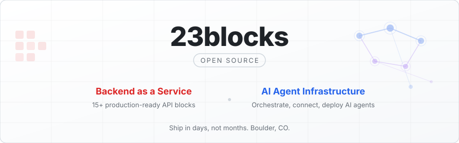

<picture>
  <source media="(prefers-color-scheme: dark)" srcset="https://raw.githubusercontent.com/23blocks-OS/.github/main/profile/banner-dark.svg">
  <source media="(prefers-color-scheme: light)" srcset="https://raw.githubusercontent.com/23blocks-OS/.github/main/profile/banner-light.svg">
  
</picture>

  
  
  

---

<table>
<tr>
<td width="50%" valign="top">

<h3>
  <a href="https://github.com/23blocks-OS/ai-maestro">AI Maestro</a>
  &nbsp;
</h3>

AI agent orchestration platform. Persistent memory, code graph queries, agent-to-agent messaging, skills system. Manage Claude Code, Codex, Grok Build and other agents across multiple machines.

</td>
<td width="50%" valign="top">

<h3>
  <a href="https://github.com/23blocks-OS/aimaestro-gateways">AI Maestro Gateways</a>
  &nbsp;
</h3>

Connect AI agents to **Discord, Slack, Email & WhatsApp**. Prompt injection defense (34 patterns), trust-based content security, timing-safe auth. TypeScript + Docker.

</td>
</tr>
<tr>
<td width="50%" valign="top">

<h3>
  <a href="https://github.com/23blocks-OS/frontend-sdk">Frontend SDK</a>
  &nbsp;
</h3>

TypeScript SDK for 23blocks BaaS. React hooks + Angular services. Auth, users, files, CRM, multi-tenant — wired up and ready to go. JSON:API compliant.

</td>
<td width="50%" valign="top">

<h3>
  <a href="https://github.com/23blocks-OS/ai-maestro-plugins">AI Maestro Plugins</a>
  &nbsp;
</h3>

Plugin builder and the AI Maestro plugin for Claude Code. Pick skills and scripts, build a plugin, install it. Messaging, identity, memory search, code graph, docs search.

</td>
</tr>
</table>

### Open Protocols for Agents

Built in the open under [agentmessaging](https://github.com/agentmessaging).

| Protocol | What It Does | Site | Spec |
|----------|--------------|------|------|
| **AMP** | Agent Messaging Protocol: signed messages between agents | [agentmessaging.org](https://agentmessaging.org) | [protocol](https://github.com/agentmessaging/protocol) |
| **AID** | Agent Identity: agent authentication with Ed25519 keys and OAuth 2.0 token exchange | [agentids.org](https://agentids.org) | [agent-identity](https://github.com/agentmessaging/agent-identity) |
| **AAP** | Agent Actions Protocol: structured UI-to-agent interactions | [agentactions.org](https://agentactions.org) | [agent-actions](https://github.com/agentmessaging/agent-actions) |
| **AFP** | Agent Files Protocol: files shared between agents and people on S3-compatible storage | [agentfiles.org](https://agentfiles.org) | [agent-files](https://github.com/agentmessaging/agent-files) |
| **ADP** | Agent Device Protocol: agents own and use real devices, signed, approved on the device, no cloud in the middle (v0.1.0, experimental) | [agentdevices.org](https://agentdevices.org) | [agent-device-protocol](https://github.com/agentmessaging/agent-device-protocol) |

<b>All Repositories</b>

 

| Project | What It Does |
|---------|-------------|
| [**ai-maestro**](https://github.com/23blocks-OS/ai-maestro) | AI agent orchestration — skills, memory, dashboard, multi-machine |
| [**aimaestro-gateways**](https://github.com/23blocks-OS/aimaestro-gateways) | Messaging gateways — Discord, Slack, Email, WhatsApp + content security |
| [**ai-maestro-plugins**](https://github.com/23blocks-OS/ai-maestro-plugins) | Plugin builder and the AI Maestro plugin for Claude Code |
| [**aimaestro-slack-bridge**](https://github.com/23blocks-OS/aimaestro-slack-bridge) | Connect Slack to your running Claude Code agents, with no extra API calls |
| [**lolabot**](https://github.com/23blocks-OS/lolabot) | LolaBot framework: an AI Chief of Staff for Claude Code. Email, semantic memory, tasks, content security |
| [**lolabot-factory**](https://github.com/23blocks-OS/lolabot-factory) | Pick a personality and skills, get an installable Claude Code plugin |
| [**agentic-seo**](https://github.com/23blocks-OS/agentic-seo) | Claude Code skill: SEO audit and implementation |
| [**agentic-sql**](https://github.com/23blocks-OS/agentic-sql) | Claude Code skill: read-only SQL on production Postgres, with a saved query library |
| [**agentic-support**](https://github.com/23blocks-OS/agentic-support) | Claude Code skill: numbered support cases and reusable runbooks |
| [**frontend-sdk**](https://github.com/23blocks-OS/frontend-sdk) | TypeScript SDK for 23blocks BaaS (React + Angular) |
| [**app-templates**](https://github.com/23blocks-OS/app-templates) | Starter templates — Next.js, Angular, React Native with 23blocks |
| [**ai-agents**](https://github.com/23blocks-OS/ai-agents) | Claude Code plugins for the 23blocks platform, one per block |
| [**ai-agents-apps**](https://github.com/23blocks-OS/ai-agents-apps) | Interactive UIs for AI chatbots powered by 23blocks APIs (planned) |

---

  We welcome contributions across all projects. 
  Each repo has its own <code>CONTRIBUTING.md</code> — pick one and dive in.

